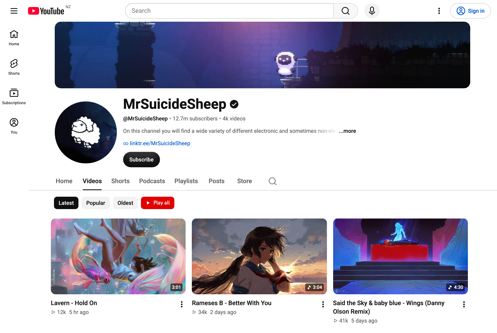

# Play All for YouTube

[](https://github.com/MRL-00/play-all-for-youtube/actions/workflows/test.yml)

YouTube used to have a **Play all** button on channel pages. It's gone. This puts
it back.

Click it once on any channel and every upload starts playing as a playlist — all
4,000 of them, not just the ~30 videos the page has lazily loaded.



## Install

Not on the Chrome Web Store, so it's a two-minute unpacked install:

1. Download `play-all-for-youtube-1.2.0.zip` from [Releases](../../releases/latest)
   and unzip it (or clone this repo)
2. Open `chrome://extensions`
3. Turn on **Developer mode** (top right)
4. Click **Load unpacked** and pick the unzipped folder
5. Pin the extension if you want the popup handy

Works in Chrome and other Chromium browsers (Edge, Brave, Arc) on version 111 or
newer. Updates aren't automatic — pull the repo or grab a newer release and hit
reload on `chrome://extensions`.

## Use

| Action | What happens |
| --- | --- |
| Click **Play all** | Uploads playlist starts at the newest video |
| <kbd>Alt</kbd>+<kbd>P</kbd> | Same thing, keyboard only |
| <kbd>Cmd</kbd>/<kbd>Ctrl</kbd>-click | Opens the playlist in a new tab |
| Toolbar popup | Play all for the current tab, plus an on/off switch |

## How it works

Every channel has a hidden "uploads" playlist. Its id is the channel id with the
`UC` prefix swapped for `UU`:

```
channel   https://www.youtube.com/channel/UC5nc_ZtjKW1htCVZVRxlQAQ
uploads   https://www.youtube.com/playlist?list=UU5nc_ZtjKW1htCVZVRxlQAQ   (4,007 videos)
```

The extension reads the channel id off the page, derives that playlist, and
navigates straight to `watch?v=<newest upload>&list=UU…&index=1` so playback
starts immediately instead of landing on a playlist page. The newest upload comes
from the channel's RSS feed (small, cacheable) with the page payload as fallback.

No API key, no account, no background requests beyond `youtube.com`. Permissions
are `storage` and `https://www.youtube.com/*` — that's the whole list.

## Where the button goes

Placement is decided per page, first match wins:

1. **Sort chip row** (`chip-bar-view-model` — the Latest / Popular / Oldest chips)
   — appended after the last chip.
2. **Header action row** (`yt-flexible-actions-view-model`, beside Subscribe) —
   used on tabs with no chip bar, e.g. a channel's Home tab.
3. **Floating pill**, bottom-right, if neither row exists.

It's deliberately red rather than theme-inherited, so it stays legible in both of
YouTube's themes instead of vanishing into a dark header.

## Notes and limits

- Playlist order is newest → oldest, same as the uploads list.
- Private, unlisted, members-only and deleted videos are not included — that's
  YouTube's uploads playlist, not a choice made here.
- Age-restricted videos pause the playlist until you confirm you're signed in.
- A few channels hide their uploads playlist entirely; the button then falls back
  to queueing the videos currently on the page (max 50, a YouTube URL limit).
- YouTube owns the DOM, so a future redesign can break the mount points. The
  three-tier placement plus a mutation observer is the hedge.

## Development

```bash
npm test          # logic tests against a real saved channel payload
npm run test:live # loads the extension in headless Chromium, clicks, asserts
npm run icons     # regenerate icons/
```

`test/run-tests.js` runs `main-world.js` and `content/content.js` inside a VM
sandbox wired together the way the browser wires the two worlds, using YouTube's
real `ytInitialData` as input. It caches the page in `test/fixtures/`.

`test/live-check.js` needs Chrome/Chromium that accepts `--load-extension` (Chrome
for Testing or Chromium — recent branded Chrome blocks the flag). Point
`CHROME_BIN` at a binary if it isn't in the default macOS location.

## Files

```
manifest.json        MV3 manifest
main-world.js        reads the page's own data (channel id, first video)
content/content.js   the button, placement, navigation, SPA handling
content/content.css  button + toast styling
background.js        Alt+P command, newest-upload RSS lookup
popup/               toolbar popup
icons/               generated PNGs
```

## License

MIT — see [LICENSE](LICENSE).

Not affiliated with YouTube or Google.
